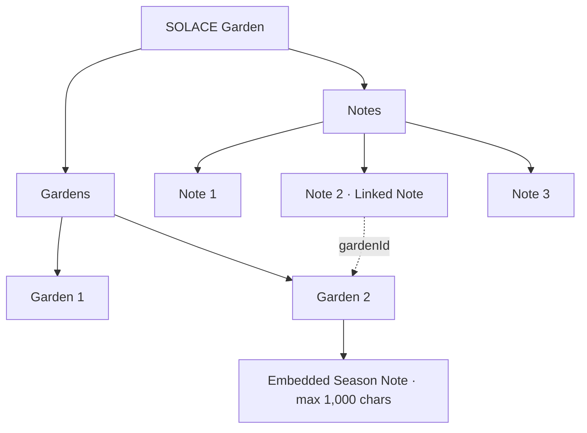

# SOLACE Garden — Technical Specification

**Status:** Working draft 0.7 — decisions confirmed through 2026-11-03; remaining implementation choices labeled as proposals.  
**Date:** 2026-11-03  
**Sources:** [GOALS.md](GOALS.md) (approved MVP direction), [COMPREHENSIVE_REVIEW.md](COMPREHENSIVE_REVIEW.md) (historical evidence), and current code in this repository.

> This document distinguishes **confirmed decisions** from **proposals**. Historical implementations are references, not architectural constraints.

## 1. Scope and principles

### Confirmed product requirements

- SOLACE Garden v1 is one locally usable, installable PWA focused on managing food gardens.
- Garden records represent distinct projects/growing cycles, **not permanent physical places**.
- The user's browser holds the working data, including imported optimized media, Journal, lists, and calendar records. No required account, remote database, or synchronization.
- Each garden has independent plant groups and harvest events. Shared tools can exist without a garden association.
- Full backup/restore is a portable, versioned ZIP containing local data and media.
- PlantDB is a separate project. Garden consumes/selects reference plants, not the full PlantDB research workflow.

### Engineering principles (proposed)

1. Keep **domain data independent of Preact, Bootstrap, and specific editors**.
2. Use stable IDs and explicit relationships; never rely on a plant name or a garden title as a unique identifier.
3. Avoid silently deleting historical data; enforce lifecycle rules in a data/service layer as well as in the UI.
4. Treat browser storage as useful but **not guaranteed permanent**; make export and validation core workflows.
5. Design for future sync without building a sync engine in v1.
6. Store timestamps and date-only values differently, avoiding timezone shifts in harvest/planting dates.

## 2. Selected scaffold and status

| Technology | Initial status | Notes |
| --- | --- | --- |
| Preact 11 | Selected / smoke tested | UI and hooks |
| Vite 8 | Selected / smoke tested | Dev/build tooling |
| Bootstrap 6.0.0-alpha.1 | Selected / smoke tested | Pin exact prerelease; audit breaking changes before upgrades |
| Dexie 4 | Selected / smoke tested | IndexedDB access |
| dexie-react-hooks | Selected / smoke tested | Reactive queries through Preact compatibility |
| preact-iso | In scaffold | Routing |
| Service-worker/PWA plugin | To select | Necessary for offline application shell; not yet verified |
| FilePond + image plugins | Preferred candidate; proof of concept needed | Local file import, resized display+thumbnail variants without server upload; verify Preact integration |
| lightGallery | Preferred candidate; proof of concept needed | Gallery/lightbox viewing; GPLv3 compatible with this project's license |
| JSZip | Preferred candidate; benchmark needed | Local ZIP backup/import; in-memory operation may be problematic for very large collections |
| Tiptap 3 open-source core | **Selected for Journal v1**; integration testing pending | Vanilla JavaScript editor engine within custom Preact/Bootstrap UI; structured JSON and custom media node; no React wrapper required |
| FullCalendar + RRule plugin | **Selected for Calendar v1**; integration testing pending | Install locally with npm/Vite (no CDN); monthly calendar UI, event/recurrence display and date selection; Preact owns forms/state |
| Browser Notification API + service-worker display when supported | **Selected for optional v1 notifications**; platform testing pending | User permission required; reminders scheduled only while app is active; no push/background guarantee |
| Test tooling | To evaluate | Confirm offline compatibility and accessibility |

The temporary `items` store in `src/db.js` is a proof of concept, **not the intended production schema**. The test demonstrated data persistence across a complete browser and Vite restart. Offline loading, large media, and restoration remain untested.

## 3. Data model overview (decided behavior; field/index details provisional)

Use stable UUIDs for user-created records; use stable seeded identifiers for system location/type presets. UTC ISO timestamps are for audit fields; user-entered gardening dates are local `YYYY-MM-DD` date-only strings. Dexie/IndexedDB has no built-in foreign keys; application services enforce integrity.

### 3.1 Locations, garden types, gardens, and templates

| Store | Fields (proposed) | V1 rules (confirmed) |
| --- | --- | --- |
| `locations` | `id`, `name`, `hardinessZone?`, optional future `address?` / `latitude?` / `longitude?`, `isSystemDefault`, timestamps | Geographic growing site, shared by many gardens. Seed built-in **Default**, which can be edited/renamed (name nonblank) **but never deleted**. Custom locations can be created/renamed and deleted after confirmation only when no current/historical garden refers to them. Optional manually entered USDA zone (1a–13b) and lookup link; no GPS/automatic lookup or address requirement in V1. |
| `gardenTypes` | `id`, `name`, `description?`, `isSystem`, `sortOrder` | Seed In-Ground, Raised Bed, Container, Greenhouse, Hydroponic, Other, Indoor, Outdoor. Stable IDs; seeded types are non-deletable. Types are independently selectable descriptors, not mutually exclusive or hierarchical; user-defined types deferred to V2/V3. |
| `gardens` | `id`, `name`, `description?`, `locationId`, `typeIds` (array of stable type IDs), `status`, `isClosed`, `layoutMediaId?`, `notes?` (Season Note), optional dates, timestamps | Every garden has exactly one geographic Location and independently selected Garden Types; a garden is an independent planting project, not a permanent place. Status Planned/Active/Completed/Archived. |
| `gardenTemplates` | `id`, `name`, `configuration`, timestamps | Save as Template **always creates a NEW named snapshot in v1**. Creating a garden from a template copies reusable configuration such as suggested name/description, location ID, garden type ID, and layout media ID; never plants or historical state. |

**Locations:** A Location is a geographic site/property, e.g. home or community garden, not a bed or growing method. The built-in Default has a stable reserved ID/system flag, is initially selected and used by Quick Start, and is **editable including its name and hardiness zone**; validate a nonblank trimmed name and **never allow its deletion**. Its name can change to Home or similar without changing the ID or Quick Start association. Additional Locations are selectable, creatable and renamable. Deleting a custom Location requires confirmation and a transactional reference check across **all** gardens, including completed, closed and archived. Referenced locations must be reassigned first; closed/archived gardens follow existing unlock rules. Hardiness zone belongs to the Location record. Optional address/coordinates and remote geographic services are deferred; never silently transmit locally stored location information.

**Garden Types:** A Garden stores `typeIds: string[]` referencing multiple valid seeded type IDs. A flat set of independent descriptors supports combinations such as Outdoor/Raised Bed/Container and Indoor/Outdoor; do **not** enforce category hierarchy, exclusivity, or horticultural conflict warnings. Show a responsive grid of toggle buttons with clear selected state and accessible multi-select semantics; use the same reusable control in Wizard and Advanced. Seed existing six types plus Indoor and Outdoor; retain stable type IDs and prohibit deletion of all seeded types. Allow editing selections only while the garden is editable; validate each ID and deduplicate selections in the service. User-defined types may be supported in V2/V3 with a unified logical catalog and optional separate store. An empty `typeIds: []` is valid for full forms and editing, and must be stored as `[]` rather than `null`; Quick Start preselects In-Ground. Reject unknown IDs and duplicates.

**Garden lifecycle:** Statuses are explicitly chosen by the gardener; finishing a plant group never changes garden status. Completed prompts optional Close Garden, but may remain editable; Archived is automatically closed/read-only; Unarchive returns to Completed/editable. Read-only enforcement must cover dependent garden data.

**Season Note:** The Garden record has its own nullable plain-text `notes` field, **not** a row in the gardener-wide `notes` store. Maximum **1,000 characters** (enforce in UI and service validation), with a visible remaining-character countdown. Optional during Close Garden and editable while the garden is unlocked. Preserve when closed/archived/reopened; include in Garden-scope search, including historical gardens. Do not copy into templates. Permanently deleting the garden deletes this embedded field with the garden.

**Templates:** V1 template configuration contains **suggested garden name, description, locationId, typeIds array, and layoutMediaId** only; the suggested name is editable when creating a garden. Applying a template creates an independent garden with a new ID, Planned status, blank start/planting dates, no plant groups/indicators/harvests/Journal/Calendar/task history. No live link or future propagation from template to created gardens. **Delete a template permanently after confirmation even when existing gardens originated from it**; deletion affects only the template record, not those gardens or any shared Gallery media. A template referenced by the create form must be revalidated on save; resolve missing/deleted media via existing placeholders. Template editing/overwriting deferred; potential later template snapshot versions remain future work.

**Garden creation workflows (confirmed V1):** The default Create Garden UI is a short **three-stage wizard**: (1) scratch or saved template, (2) name, Location and Garden Type, (3) review/create. **Quick Start** provides immediate creation with **garden name as the only required input**, default Location = protected `Default`, typeIds = [`in-ground`], status = `Planned`, no planting/start date and no plant groups/layout/other optional data. A Quick Start garden is a normal persistent garden, not a draft, and may be completed later. **Advanced** exposes the wizard's full configuration (including optional description, dates and layout reference) in a single form. Wizard and Advanced share the **same in-memory state**, validators and creation service so switching views doesn't discard entered data; each flow creates a garden through the same validated Dexie transaction and navigates to the new garden detail view. Template selection prefills editable name/description/location/typeIds/layout values; optional plants are added after creation. Auto-generated UUID and timestamps are never user inputs. Historical `garden_quickstart.json` / `garden_full.json` are conceptual references, not current storage schemas.

### 3.2 Plant groups and harvests

| Store | Fields (proposed) | Confirmed rules |
| --- | --- | --- |
| `plantGroups` | `id`, `gardenId`, `plantDbId?`, `displayName`, `quantity?`, `plantingDate?`, `phases`, `notes?`, timestamps | `quantity` denotes **count of plants** in v1. Repeated PlantDB varieties are independent planting groups; never share status/history merely because IDs match. |
| `harvests` | `id`, `plantGroupId`, `date`, `itemCount?`, `weight?`, `weightUnit?`, `notes?`, timestamps | Date required; whole-number count and/or positive weight required; unit required if weight present; no volume in v1. |

**Ten plant phases:** Seeds Started, Germinating, Seedling, Transplanted / Planted, Vegetative Growth, Flowering, Fruit Production, Harvesting, Dormant, Finished. Each phase has `active: boolean`, optional `startDate` and `endDate` (date-only strings). Store as keyed objects under `phases`. Each phase's end cannot precede its start; different phases may overlap, and multiple active booleans may be true. All activation and date entry remain manual; both start and end fields have an independently applied **Today** shortcut, using the user's local date. No implicit date fill, phase transitions, or advancement. Smarter transition suggestions deferred (possibly v3).

**Harvest units:** Gardener-wide `settings.measurementSystem` is `imperial` by default; can select `metric`. Imperial weight selection: oz/lb; Metric: g/kg. Store the **actual unit on every record**; changing preference does not reinterpret saved values. Derive count totals and compatible weight totals separately, with explicit conversions; never infer absent weights. V2 planned: volume and volume units (cups, quarts, gallons, milliliters, liters, bushels, pecks); do not convert volume to weight without commodity-specific information.

**PlantDB V1 static reference catalog (confirmed):** For Garden V1, bundle a **read-only JSON catalog** in `public/assets/data/plants.json`, initially using the archived `garden-archive/app/garden/plantdb/js/plants.json` (69 records, about 21 KB). Its records contain a string `pid` (preserve leading zeros), name, scientific name, categories, URL aliases and image reference; adapt archived image paths for Garden's static asset layout. No backend PlantDB, database queries, published-data manifest, automatic version checks or runtime API are required to ship Garden V1. Garden search covers the gardener's saved Garden records; the plant-picker search operates separately over this static catalog.

**PlantDB catalog access:** Load the JSON once via a small `PlantCatalogService` with a shared fetch/promise cache, expose read-only catalog state and helpers such as `findById` and `searchPlants` through a **Preact Context Provider**, and use `useMemo` for lookup maps/derived searches only if useful. A direct case-insensitive in-memory name search is sufficient at this size. Keep the interface replaceable so the future publisher can supply a compatible JSON without rewriting plant-selector UI. Persist gardener-owned plant groups independently in Dexie with `plantDbId` and a `displayName` snapshot; catalog edits/refreshes never overwrite personal records. Handle missing/unknown references gracefully; exact custom-plant interaction can be refined during implementation.

**PlantDB static image assets (confirmed):** Bundle reference photos as **static application assets**, for example `public/assets/data/plantdb/images/`, and store matching public relative URLs in the catalog. Render images on demand with ordinary image URLs and browser lazy loading; the PWA/service worker resolves cached resources—not arbitrary direct filesystem access. **Precache the optimized plant-selection thumbnails** with the catalog so offline plant browsing has images even before a particular thumbnail has been opened (subject to size testing). Optional larger reference photos may load on demand and only be available offline after caching; provide a bundled fallback image. Reference images live outside Dexie, do not duplicate into the gardener's Gallery, and **do not count toward the configurable 250 MB personal-media budget**. Audit copied assets, rights/attribution, and their total cache size.

**Separate future PlantDB project:** A dedicated PlantDB `GOALS.md`/`TECH_SPEC.md` will define the authoritative server-side database (e.g. MariaDB), administration, publication to `https://garden.solace.network/assets/data/`, schema/data version manifests, compatible catalog updates, and any community contributions. This **is not a Garden V1 dependency**. Garden's service/catalog boundary should permit later versioned data and image updates while preserving the last known-good cached catalog and all saved garden records.

### 3.3 Gardener-wide records

| Store | Key fields | Rules |
| --- | --- | --- |
| `journalEntries` | `id`, `title`, `entryDate`, `content`, `contentFormatVersion`, `createdAt`, `updatedAt` | Dated personal Tiptap/ProseMirror structured JSON with shared media IDs. Entry date is user-selected and independent of audit times. No publication/draft distinction. |
| `listItems` | `id`, `kind`, `text`, `completed`, `sortOrder`, `gardenId?`, `quantity?`, `notes?`, `url?`, timestamps | `kind` identifies **Tasks** or **Wish List** (legacy conceptual names todo/tobuy may remain internal until schema finalized). One gardener-wide collection; Wish List tracks purchased status and optionally quantity, details and user-entered product URL. |
| `notes` | `id`, `text`, `gardenId?`, timestamps | Gardener-wide quick **Note**; becomes a **Linked Note** when `gardenId` references a garden. This is not the embedded Season Note. |
| `calendarEvents` | `id`, `title`, `eventDate`, `startTime?`, `description?`, `allDay`, `recurrenceRule?`, `reminderEnabled`, timestamps | Manually created one-off or recurring events; local calendar dates/times, optional at-time reminder, entire-series edits in v1. Recurrence is stored as a rule, not pre-expanded occurrences. |
| `settings` | `key`, `value` | Measurement system; **250 MB default** configurable total media-storage budget; calendar all-day reminder time (`09:00` default), clock format (`12` default), browser notifications toggle (`false` default). Geographic Locations and their hardiness zones remain in the `locations` store; no separate global preferred-location preference in V1. |

**Shared gardener-record rule:** Notes, Tasks and Wish List items survive garden completion, closure, archiving and reopening with their optional `gardenId` intact. Permanent garden deletion atomically clears their `gardenId` to `null` rather than deleting those independent records. A garden association is not ownership. Keep all items in their gardener-wide listing regardless of garden status; filters by garden can be added where useful.



**Future Wish List scope:** V2 may add tags/filtering; V3/V4 or later may support explicitly shared public gift Wish Lists. No public or account functionality in V1.

### 3.3a Journal editor, media references and lifecycle (confirmed V1 behavior)

**Editor engine and UI:** Use **Tiptap 3 open-source core** through its vanilla JavaScript API, integrated into a **custom Preact/Bootstrap 6 Journal UI**. Tiptap owns editing operations, selection, structured JSON, and built-in multi-level **Undo/Redo**; Preact owns the toolbar, page, cards, and dialogs. No React UI dependency or full word-processing features. Limit V1 formatting to paragraphs/headings, bold/italic, bulleted/numbered lists, links, and Gallery photos. Editor configuration and extension choices require a small implementation proof of concept.

**Document persistence:** Store `editor.getJSON()` (ProseMirror-style document JSON) in `journalEntries.content`, with `contentFormatVersion` to support later migrations. Never persist object URLs, copied Gallery blobs, or unsanitized arbitrary HTML as the authoritative entry content. A custom `gardenImage` node carries stable `mediaId` and optional independently editable `caption` and `alt` attributes. Suggest caption text as initial alt text if useful, but don't permanently equate a visual caption with accessible description. Resolve the media ID at render time through the shared media service; missing/deleted blobs display the bundled placeholder without erasing references. Reused images do not create separate media copies.

**Entry lifecycle:** Creating a new entry requires valid title/content; the date is editable and stored separately from `createdAt`. Saving is an **explicit** action with no autosave, Draft, or Publish states. Save is disabled for no changes/invalid content; dirty-state comparison should account for title, entry date, structured JSON and image attributes, including when Undo returns content to its last saved state. Only clear dirty state and disable Save after Dexie confirms a successful write; on save error preserve edits for retry. Built-in multi-level Undo/Redo applies within a single editing session; reset editor history when opening another entry. Do not implement persistent edit history in v1.

**Unsaved changes:** On in-app navigation, show a native `window.confirm()` prompt if dirty; accept = discard and navigate, cancel = stay. For tab refresh/close, use `beforeunload` only while dirty and where supported; browser/mobile platforms may suppress the prompt, so don't promise loss prevention.

**Deletion:** Require explicit confirmation; remove the Journal record permanently from the active Dexie dataset in v1. **Never delete a referenced Gallery media record or blob** solely because the Journal entry was deleted. The entry's embedded references disappear with the entry; garden and other Journal references are unaffected. This is different from Gallery deletion, which retains media tombstones. Previously exported ZIP backups may still include a deleted entry. Journal trash/restore, autosave, and entry versioning are possible v2/v3 additions, not v1 work.

**Journal browsing:** Default newest first by `entryDate` (stable secondary order for equal dates). Custom reusable `JournalPage`, `JournalArchive`, `JournalCard`, `JournalList`, `JournalEntry`, `JournalEditor`, `JournalToolbar`, and `JournalImage` components are provisional file/component names. Cards show date, title, excerpt and optional photo; text-only cards remain visually coherent. Allow grid/list views, optional year/month filters and a Load More/pagination mechanism. Desktop (roughly >=992px): archive sidebar + two-column card grid; tablet: archive filters above cards; mobile (roughly <768px): stacked controls and single-column cards with compact year/month selector. Final CSS breakpoints/interaction details can be refined during implementation. Avoid a separate popup Journal/navigation system.

**Source reference:** Historical PHP Journal under `garden-archive/app/garden/journal/` is a UI/feature reference, not code to port. Untitled UI's blog layouts are design inspiration only; don't copy proprietary components or add React/Tailwind.

### 3.3b Calendar, recurrence, notifications and clock (confirmed V1 behavior)

**Presentation and persistence:** Use **FullCalendar** with **RRule** installed through npm and bundled by Vite for offline operation; no runtime CDN. Render a month-view calendar (mobile-responsive) and use custom Preact/Bootstrap event forms and date-click interactions. Events are private, gardener-wide, created manually; date required, optional start time and description; an omitted time means an **all-day** event. FullCalendar is a calendar UI/recurrence-expansion layer, not the database or alarm scheduler. Keep business rules and persistence independent of the UI library.

**Recurrence:** One-time events plus daily/weekly/monthly/yearly recurring series using RRule. Persist a stable series ID and recurrence definition; generate/display occurrences for the requested view rather than storing each as a separate event. **Editing or deleting a recurring event affects the whole series** in v1. Per-occurrence edits, exclusions, skipping, and individual completion history are outside v1. Specify a sensible finite/unbounded-series representation and inclusive/exclusive boundaries when implementing; test DST and month-end recurrence.

**Reminders:** `reminderEnabled` is an optional event-level choice. Deliver **at the event's start time only** (no lead-time offsets). A timed event uses its stored local start time; an all-day event uses a gardener-wide `calendar.allDayReminderTime` setting defaulting to `09:00`, evaluated at occurrence time rather than copied into individual events. Changing the setting affects subsequent reminders. Maintain lightweight occurrence-aware delivery/dismissal state keyed by event/series ID plus occurrence date/time (separate Dexie store or equivalent; exact indexing TBD) so an open tab/restart doesn't repeatedly alert for the same due instance. **Missed occurrences are discarded** when Garden is reopened; never enqueue catch-up or overdue reminders. The next future recurrence remains eligible. Multi-tab deduplication requires testing.

**Notification channel selection:** In-app notification indicator/alert is the V1 default. `notifications.allowBrowser` setting defaults `false`. Only when the user enables it from an explicit interaction should the app call `Notification.requestPermission()`; browser permission is also separately checked. If enabled, permitted, and supported, display **one browser notification in place of** the in-app popup; if denied/unavailable/not delivered, show the in-app alternative where possible. On mobile, prefer a registered service worker's `showNotification()` when supported rather than assuming `new Notification()` works. No push subscription or background scheduling. Turning the toggle off immediately stops application-issued browser notifications and reverts to in-app reminders; **JavaScript cannot revoke previously granted browser/site permission**. Explain how to revoke it through browser settings if desired. Permission state and app preference are distinct; don't infer the toggle is true just because permission is granted.

**Running-PWA limitation:** The reminder checker runs **only while SOLACE Garden is active**; native notifications still need a living app context to schedule them. Warn users in settings/event UI that reminders are not guaranteed after closing/suspending the PWA and may be delayed by browser throttling. Offline event display and in-app checking work without a network, subject to local browser limitations.

**Device-local timekeeping:** The system clock and local time zone reported by the browser are authoritative for v1. No NTP/external service, user-adjustable app clock, or incorrect-clock compensation. Store date-only strings (`YYYY-MM-DD`) and local wall-clock times (`HH:mm`) rather than interpreting them as UTC timestamps or fixed offsets; derive actual instants in the local time zone for matching reminders and recurrence. Retain 9 AM local time through DST changes. `calendar.clockFormat` (`12` by default, or `24`) affects formatting of FullCalendar, details and reminder messages **only**, never event instants. Native HTML time inputs might follow device locale instead of the app's clock-format preference.

**V1 tests:** Confirm daily/weekly/monthly/yearly recurrence and whole-series editing/deletion, local start-time and all-day 09:00 behavior, clock format display, DST/zone changes, browser permission states, enable/disable fallback, single-channel delivery, occurrence deduplication, offline while open, suspended/closed-browser limitations, and ZIP backup/restore of rules/settings/reminder state.

### 3.4 Shared media and reference protection

| Store | Key fields (proposed) | Rules |
| --- | --- | --- |
| `media` | `id`, `kind`, `title?`, `description?`, `tags[]`, `originalFilename?`, `photoDate`, `year` (derived/indexed), `originalWidth?`, `originalHeight?`, `originalSize?`, `status`, `deletedAt?`, timestamps | Metadata and tombstones. **No single `gardenId`**; optional user fields. Preserve photo date/provenance after removal of binaries. |
| `gardenMedia` | `id` or composite `[gardenId+mediaId]`, `gardenId`, `mediaId` | **Many-to-many**: a single photograph can appear in multiple gardens without blob duplication. Unlinking removes only this association. |
| `mediaData` | `id`, `displayBlob`, `thumbBlob`, optional MIME/size info | Optimized image + thumbnail only. Never store the full-resolution original. |

**Import:** Select source file from device; FilePond (preferred) with preview/validate/resize/transform plugins produces both variants; receive processed files in an app media service and store in Dexie, without network upload. Test plugin variant output and Preact lifecycle. Preserve device originals untouched. Proposed targets (not yet agreed): 1920px longest edge display and 256px thumbnail; image format, quality and exact defaults remain benchmarks, not fixed requirements.

**Gallery organization:** Derive year from `photoDate`; prefer EXIF original capture timestamp, then source file's last-modified time, then import date. Allow manual correction. Title, description and tags optional. Group main Gallery by year; garden-specific queries use `gardenMedia`; Journal and garden layout/template can reference the same `media.id`. Avoid persisting temporary object URLs.

**Deletion v1:** Distinguish **unlink from garden** (delete one `gardenMedia` relationship) from **delete from Gallery** (warn about references and require confirmation; delete optimized blobs and retain media record with `status: 'deleted'`, deletion timestamp, and all garden/Journal/layout/template references). Present a bundled placeholder in any view of deleted/missing photos. Distinguish intentional deletion from accidental missing/corrupt blobs conceptually. Tombstones preserve the ID and metadata, allowing future restoration. Use transactions/services to keep metadata and binaries consistent.

**Future media restoration:** User reimports a candidate original; compare filename/date/dimensions/size and potentially perceptual fingerprints, then **confirm** before restoring blobs onto the existing media ID; all previous references reconnect without rebuilding associations. Automatic detection/repair and holistic missing-image recovery are **not v1**.

**Storage and optimization defaults (agreed V1 starting values):** Gardener-configurable total media budget **250 MB by default**; upper/lower bounds and increment to validate in UI testing. Display images: **1920px longest edge maximum**; thumbnails: **256px longest edge maximum**; **WebP preferred with compatibility fallback**, approximately **80% compression quality** as a starting point. Benchmark browser support, output format/quality, memory, image clarity and photo import performance before finalizing implementation constants. Track optimized display+thumbnail bytes, warn before/near budget, and handle quota failure; browser quota is independent of the user budget and can be smaller.

## 4. Milestone 8A initial Dexie schema (agreed scope; not yet applied)

**Current implementation status:** Dexie was installed and smoke-tested, but there is no active Garden database or production CRUD implementation. Milestone 8A starts the real data schema at Dexie version 1. The schema below contains **only the six stores needed for 8B–8F**; introduce other stores and uncertain indexes in their owning later milestones through normal versioned upgrades.

Dexie `stores()` entries below define primary keys and indexes, not every property stored on the objects. Final index choices should be checked against the concrete queries before implementation:

```js
// Proposed six-store data schema for Milestone 8A.
db.version(1).stores({
  notes: 'id, gardenId, updatedAt',
  listItems: 'id, kind, gardenId, [kind+sortOrder]',
  locations: 'id, name',
  gardenTypes: 'id, name, sortOrder',
  gardens: 'id, name, locationId, *typeIds, status, updatedAt',
  gardenTemplates: 'id, name, updatedAt'
});
```

**8A responsibilities:** Create the six empty stores and their primary/index definitions. Use stable UUIDs for gardener-created records; maintain stable, reserved identifiers for system presets. Do not populate demonstration records. Idempotent system Location and Garden Type seeding, feature CRUD, lifecycle rules, forms and specialized queries belong to their corresponding 8B–8F slices. Shared validation conventions may begin in 8A, with entity-specific rules added alongside features.

**Versioning policy:** Number schema versions normally, retain prior version declarations when upgrading, and perform safe migrations where data transformations are necessary. Never delete and recreate a user's active database as an upgrade strategy.

**Historical Dexie smoke test (deprecated, not an active application database):** Following the initial Dexie installation, Milestone 3 temporarily exercised CRUD and reactive queries using a test `SolaceGardenDB` version 1 / `items` store. These checks validated library integration only. The temporary smoke-test source was removed, and **the current Garden skeleton does not initialize or use that database**. The current application is a Preact/HTML/JS/CSS interface scaffold without persisted Garden records; the user also inspected the current browser's IndexedDB panel and found no Garden dataset. Old test database names/schema should not be treated as production state or as an application migration requirement.

**Milestone 8A production starting point:** Use the stable logical identity `solace-garden`, but resolve each **physical** data database name from the separate `solace-config` control store. Generate physical names as `solace-garden-data-<uuid>` using `crypto.randomUUID()`, including for the initial database. Start the Garden data schema at version 1 with the six 8A–8F stores defined above; reference-data seeding happens when its feature is implemented. No migration from `SolaceGardenDB` is planned because it was a deprecated, temporary smoke test, not a supported Garden data store. As with any browser-origin storage, isolated test data may exist in other browser profiles/origins, but there is no evidence of live application data requiring conversion. **From the first production release onward**, retain version declarations and use safe additive/transformational migrations rather than deleting users' databases.

## 5. Data access and UI boundaries (proposed)

- `db` module: Dexie instance and schema evolution only.
- Domain services/repositories: create/edit/delete operations, validation, template cloning, lifecycle enforcement, and reference cleanup.
- Preact pages/components: rendering and user interaction; use storage-neutral hooks/services for reads and domain services for writes. Any Dexie-specific `useLiveQuery` usage stays inside an adapter-aware integration layer, not general presentation components.
- Media service: import, optimize, create display object URLs, revoke them, maintain references, and delete safely.
- Backup service: export/import and archive validation without being coupled to UI components.

Avoid putting business rules solely in individual click handlers. Database foreign keys are not enforced automatically by IndexedDB; deletion and relationship integrity must be implemented and tested in application code.

### 5.1 Responsive interface modes and interaction patterns (V1 agreed behavior; layout details under review)

**Shared application:** Build Simple Mode and Standard Mode as presentation/navigation choices over common Preact state, Dexie stores, and domain services, not independent products or data models. The mode should not control whether a user has access to their saved data. Responsive Bootstrap styling works within either mode; a manual choice is never overridden by media queries.

**Preference:** Persist one local settings record, proposed `settings.interfaceMode = 'auto' | 'simple' | 'standard'` (default `auto`). Expose three mutually exclusive **native Bootstrap radio buttons** in Settings, with labels Automatic, Simple Mode, Standard Mode. Settings must be reachable from either interface. Resolve effective mode as `preference === 'auto' ? (viewportMatchesNarrowBreakpoint ? 'simple' : 'standard') : preference`. Implement responsive detection with `matchMedia` and a change listener (properly cleaned up on unmount); the exact Bootstrap-aligned breakpoint is **not yet selected**. Browser desktop-site requests may alter the reported viewport and must not be treated as a dedicated mode signal. Switching modes or resizing while a form is dirty must preserve edits or ask before discarding them.

**Simple Mode entry points:** Candidate main home destinations, discussed and favored for V1, are **Plants, Harvest, Photos, Tasks, Calendar, Notes** as large, high-contrast, touch-friendly buttons. Prefer task-focused workflows over nested hamburger navigation for frequent outdoor operations. **Notes** opens a fullscreen browse/add/edit/delete workspace; **Calendar** opens a view/add/edit workspace (not merely an Add Event shortcut). Photos supports capture and viewing; Tasks supports checking off and potentially reordering work. Detailed UI compositions remain Milestone 1 questions, not finalized wireframes.

**Plant group update navigation (agreed):** From Simple Mode home, tap **Update Plants** → display existing plant groups for the current garden → tap a group to **immediately** open its fullscreen editor. The selector reads gardener-owned `plantGroups` in Dexie, not the PlantDB reference list; distinguish repeated varieties by garden and identifying metadata. The editor presents the **ten independent phase indicators**, each manually toggleable, with existing optional start/end date controls; e.g. turn Seedling off and Vegetative Growth on without changing unrelated indicators. **Save/Done** commits via shared domain services and returns to the **plant-group list**, retaining search/filter and scroll position for repetitive updates. The upper-left SOLACE Garden logo leads directly to Simple Mode home. Distinguish this from **adding** a plant group, which uses the static PlantDB catalog selector. When arriving from an already selected group, skip redundant selection.

**Dialog conventions:** On phone-sized viewports, use a Bootstrap fullscreen (or breakpoint-responsive fullscreen) modal for choosing/editing plant groups and other focused actions; a conventional dialog or responsive layout is acceptable on wider screens. A conspicuous **upper-right X** should have at least a ~48 × 48 CSS-pixel hit target, clear accessible label and contrast, and act as **Close/Cancel**, never Save. Dirty forms require discard confirmation; consider disabling accidental backdrop dismissal for sensitive forms. Use explicit Save/Done buttons, wait for successful Dexie persistence before showing saved state, and return to the user's working context. Offcanvas panels are available for secondary choices or contextual info, but are not required for everyday Simple Mode navigation.

**Standard Mode emphasis:** All garden activities should remain usable even when Standard Mode is selected on a narrow phone viewport; favor richer navigation and management tools for creating/editing gardens and templates, garden-layout work, full Journal editing with images, Gallery metadata/bulk organization, archived-garden administration, and backups/settings. The old navbar/sidebar/Infobox/statusbar and mobile Infobar are historical reference ideas **rather than required UI structures**. Contextual information may use inline cards, expandable details, or an optional panel depending on screen and task.

**Device boundary:** No automatic cross-device sync in V1. Data entered on a phone remains in that browser's local Dexie database until explicitly transferred via ZIP backup/restore; do not imply that changing presentation modes or opening Garden on a desktop makes phone data available there.

**Open design questions:** Exact automatic breakpoint, Standard Mode navigation, context-information presentation, mode-switch shortcut placement outside Settings, detailed desktop/mobile wireframes, and precise six-action placement/labels will be finalized during Roadmap Milestone 1. Record these as open choices instead of implying a completed visual design.

### 5.2 Settings, preferences, and location data

**Settings placement (agreed):** Expose geographic **Location management**, each Location's optional **USDA Hardiness Zone**, **units** (Imperial/Metric), **theme** (Light/Dark/Automatic), and **interface mode** (Automatic/Simple/Standard) through Settings. The Locations workspace may remain a detailed management destination reached from Settings. Hardiness zone belongs to each `locations` record, not one global setting. Wizard/Advanced show a Location select with the built-in record initially selected; Quick Start always references its stable ID even if renamed. No global preferred-Location setting or automatic geolocation is necessary for V1. V3/V4 may consider optional explicit-consent online features such as weather, frost, maps and estimated sunlight; never transmit geographic data without separate authorization.

Units/theme/interface-mode are gardener preferences and must remain separate from storage-provider configuration. Interface mode is implemented in the current shell; units and theme are not yet implemented. Do not imply theme implementation, a theme default, or preference-migration behavior has been settled by listing the intended Settings controls.

### 5.3 First-run informational Welcome (confirmed V1 behavior; implementation pending)

- Implement Welcome as a **normal application route** (`/welcome`), not a modal, blocking overlay, or garden-creation wizard. The usual app navigation remains active.
- At startup, after preferences are loaded, automatically navigate to `/welcome` **only** when `welcomeSeen` is absent/false and the launch is at the app's normal starting route. Never intercept a direct/deep link such as `/calendar`.
- When the Welcome page successfully renders for the first time, persist `welcomeSeen: true` in the existing persistent application-settings mechanism (prefer the established settings store rather than a cookie; do not add a second competing preference store). This is **display-triggered**, not button-triggered; navigating away via any normal UI control requires no acknowledgment.
- Once true, the flag stays true across app restarts and version upgrades. A manual revisit via Help/About does not clear it. Clearing browser site data may reset the flag, as with other locally stored preferences.
- The page explains Garden's purpose, directs users to the existing Create Garden workflow (Wizard/Quick Start/Advanced), and during beta identifies beta status. Include concise local-only data and backup guidance, documentation, and a link to the repository's GitHub issue tracker. No new garden-creation flow is introduced.
- Ensure preference reads/writes are asynchronous-safe: avoid redirect loops or flashing Welcome on every startup while settings are loading. If persistence fails, do not block navigation; handle the failure through normal application feedback.
- Acceptance cases: new installation opens Welcome from the normal entry route; user can navigate away without clicking anything; refresh/relaunch skips automatic Welcome; deep links retain their destinations; manual revisit works; app update does not reset the flag.

## 6. Search (proposed)

One search entry point with scopes: Garden (default), Lists/Notes, Calendar, Journal. Search Plant Group names, Garden names **and embedded Season Notes** locally, including completed/archived gardens. In Lists/Notes results distinguish **Note**, **Linked Note** (show the linked garden), and **Season Note** (which navigates to its Garden record). Season Notes are part of Garden scope, not separate Notes rows. Garden status and specific garden are optional filters. Exclude PlantDB's botanical reference corpus.

For v1, a debounced query over relevant indexed/locally loaded data may suffice; measure performance before choosing a dedicated full-text engine. Search field sets, normalization, and limits remain TBD.

## 7. Backup and restore (confirmed V1 policy; implementation pending)

**Library:** JSZip is the preferred candidate for portable ZIP import/export; benchmark memory use with large collections, especially mobile devices. It does not expose uncompressed entry lengths through its supported public entry API, so record aggregate **uncompressed sizes in our own manifest**. Validate claimed sizes against trusted limits and actual content; do not trust manifest values blindly.

**Archive layout (proposed):**

```text
solace-garden-backup-YYYY-MM-DD.zip
  manifest.json
  solace.config.json
  data/locations.json
  data/gardenTypes.json
  data/gardens.json
  data/gardenTemplates.json
  data/plantGroups.json
  data/harvests.json
  data/journalEntries.json
  data/listItems.json
  data/notes.json
  data/calendarEvents.json
  data/media.json
  data/gardenMedia.json
  data/settings.json
  media/<media-id>-display.<ext>
  media/<media-id>-thumb.<ext>
```

**Portable configuration:** `solace.config.json` is an app-namespaced JSON document for exportable gardener preferences where appropriate, subject to schema/version validation. It is **not** a copy of the local `solace-config` control database. Exclude active/previous database names and pointers, staging status, rollback metadata, deployment driver selection, endpoints, credentials and other installation-specific values; importing a ZIP must never replace the control database or blindly apply these settings. The existing `data/settings.json` archive entry may be retained for record-based settings if needed; avoid duplicating preference values between it and `solace.config.json` when finalizing the format.

The final manifest should carry `application`, `formatVersion` (independent of app/Dexie versions), app version, timestamp, record counts, `storage.dataBytes`, `storage.mediaBytes`, and `storage.totalBytes`. The listed media filenames are conceptual, not an authoritative finalized naming convention. Do not export redundant `mediaData` JSON when binary files are already exported. Deleted-photo tombstone records/references stay in JSON; deleted blobs are absent.

**Standalone Backup Validator (confirmed V1 feature; implementation at 8N):** Implement storage-independent, read-only `BackupValidator.validate(file)` returning a structured report (at least `valid: boolean`, supported `formatVersion` when readable, categorized `errors[]` and `warnings[]`), plus convenient `BackupValidator.isValid(file): Promise<boolean>` using the **same** validation engine. This accepts a SOLACE Garden ZIP without importing it, creating a staging database, changing `solace-config`, or modifying current Garden records. Make it accessible as a user-facing **Validate Backup** action and reusable by import, export verification and automated tests; a future CLI/API wrapper could reuse the validation specification but is not V1 scope.

**Validation layers:** (1) file/archive validation (supported version, manifest, required members, path safety, count and decompression bounds, declared/actual lengths and integrity); (2) entity-specific record validation (required/optional fields, IDs, values and enums, with shared domain validators used by ordinary CRUD); (3) dataset-wide validation (unique IDs, cross-store references, media existence/checksums and coherent tombstones). Provide actionable coded errors, including affected paths/record IDs when available, and distinguish fatal errors from non-fatal warnings. Apply resource limits during scanning; validation means a supported, internally consistent **archive**, not a guarantee of enough device storage or a successful restore. Device-specific quota/runtime/preflight and staged-database readback are separate restore-feasibility checks.

**Validation delivery sequence:** Milestone 8A defines a minimal shared domain validation convention and implements only validators needed for its actual schema. Add entity validators alongside their owning features; build full ZIP/dataset scanning and `validate`/`isValid` in Milestone 8N. Avoid duplicating validation logic within import and export, but do not build speculative complete validators in 8A. **AJV/JSON Schema is an optional library candidate** when schemas and representative archives exist; do not add it in 8A merely in anticipation. Schema checking does not replace cross-record/media integrity checks.

**V1 restore is replace-only, not merge.** Never replace existing records in place. Restore sequence:

1. Inspect ZIP manifest/version/structure, enforce archive path/count/size bounds, validate record schemas and ID integrity, and present a backup preview. Avoid blindly trusting archive content (including stored HTML).
2. Before writing a staging database, call `navigator.storage.estimate()` and compare **estimated extra storage requirement** (manifest uncompressed bytes plus conservative IndexedDB overhead) with `quota - usage`. Existing data is already counted in `usage`; do not double count it. Preflight estimates are advisory, not guaranteed available disk space. Enforce independent limits and catch `QuotaExceededError`.
3. Create a **separate staging IndexedDB database** using target schema, populate it from ZIP, and check referential integrity, records, media availability, and data readability. Preserve IDs and intentionally deleted tombstones.
4. Only after successful staging, explicitly confirm replacement and switch the durable **active-database pointer** in the separate `solace-config` control database to staging. IndexedDB does not support database renaming; do not attempt to rename. Coordinate other open tabs and recover cleanly from interrupted switch.
5. Restart/reopen on the staged database, verify successful loading, and **retain prior database temporarily** for rollback. Delete previous database only after successful activation/recovery verification.

If validation, quota, or restore fails, discard staging and leave the current active database unchanged. A crash during pointer switching must have a recovery path. Consider retaining user-controlled backup of old data before restore. No cloud account required.

**JSZip memory limitation:** ZIP generation/extraction may require considerable memory beyond archive size; benchmark with realistic photo counts and consider a streaming ZIP implementation if necessary before shipping V1. Compressed JPEG/WebP assets should generally use ZIP STORE/no redundant compression where appropriate.

## 8. Offline/PWA and storage reliability

- **Implemented application-shell infrastructure (production acceptance pending):** Vite uses the installed `vite-plugin-pwa` with Workbox `generateSW`. The generated manifest is root-scoped (`start_url` and `scope` are `/`), uses standalone display and the existing 192 × 192 and 512 × 512 PNG icons, and retains the SVG favicon in `index.html`. The manifest link requests credentials for the HTTP Basic Authentication deployment.
- The generated service worker precaches revisioned Vite JavaScript/CSS/HTML output, Bootstrap Icons `.woff` and `.woff2` files, shell branding, and application icons. `index.html` is the SPA navigation fallback so already-cached client routes can open offline. There are no runtime API cache routes. Initial glob rules explicitly exclude `assets/plantdb/` and `assets/temp/`; PlantDB JSON/thumbnail caching remains deferred until its catalog format and asset budget are implemented and validated.
- Service-worker registration is explicit through `virtual:pwa-register` with `registerType: 'prompt'`. A non-modal Preact status notice offers **Update now** and **Later**. Workbox does not use unconditional `skipWaiting` or `clientsClaim`; the waiting worker is activated only after **Update now**, then the plugin reloads once the updated worker controls the page. **Later** dismisses the notice without disrupting the current editing session; a waiting or subsequent update can notify again on an appropriate later registration/update event.
- Precache installation is atomic: a missing or non-successful required response (including an authentication/error response) fails service-worker installation rather than being stored as a successful shell resource. This does not replace production verification behind Basic Authentication. A first authenticated online visit is still required to obtain and cache the application, and browser credential/session behavior can affect later offline cold starts.
- IndexedDB data access is independent of the service worker. Application deployments and cache cleanup do not modify, rename, delete, or replace `solace-config` or the active `solace-garden-data-<uuid>` database; storage recovery and schema lifecycle remain separate from the PWA cache lifecycle.
- Evaluate `navigator.storage.estimate()`, `navigator.storage.persist()`, browser quota failures, and large gallery imports.
- Clearly explain that browser profile deletion, private browsing, eviction, or device loss can remove local data; ZIP exports are essential.
- Test offline navigation, cold starts, updates, and preservation of existing records across application builds.
- Outstanding production acceptance: Desktop Chrome install; Android Chrome install; standalone launch; authenticated first-load/cache completion; offline warm and cold starts; offline route navigation; new-deployment detection; **Later** and **Update now** behavior; IndexedDB preservation across updates; and Hostinger Basic Auth behavior. Do not claim the PWA milestone complete until these checks pass on the deployed origin.

## 9. Security and content handling

- Sanitize or safely render user-authored rich text and restrict allowed links; do not trust imported backup HTML.
- Do not persist unsafe blob/object URLs. Revoke object URLs when no longer needed.
- Validate ZIP members against unsafe paths, excessive decompression sizes, and unsupported format versions.
- No application-level encryption requirement in v1. Exports are not implicitly encrypted.

## 10. Testing strategy

1. Unit-test domain rules: statuses/close/reopen, independent plant groups, indicator toggles, harvest totals by unit, template copying.
2. IndexedDB integration tests: migrations, invalid IDs, cascading-or-restricted deletes, media references, live queries.
3. End-to-end tests: create garden, add repeated plant variety, record multiple harvests, close/archive/reopen, create/edit Journal with Gallery photo and caption, save/reload JSON, Undo/Redo, unsaved-change confirmation, permanent Journal deletion without deleting shared photos, backup/restore.
4. Reliability tests: complete browser restart, offline PWA launch, storage quota failure, large media import/restore, backup version incompatibility.

## 11. Remaining questions and validation tasks

1. **Garden creation:** Implement shared wizard/Quick Start/Advanced form state, template prefill, transactional validation, and the protected location/type deletion rules. V1 template field-copy and deletion semantics are decided; test them.
2. **PlantDB:** Bundle archived JSON and optimized reference thumbnails; update asset paths, verify Preact Context/provider and single-fetch behavior, precache offline assets, handle missing plant IDs and broken images, and test image bundle size. Server publishing/version manifests belong to a separate future PlantDB specification.
3. **Gallery implementation:** Confirm FilePond no-network variant handling, lightGallery integration, image format/quality/target dimensions, thumbnail performance and metadata extraction.
4. **Storage budget:** Default is 250 MB; confirm configuration range/steps, threshold warnings, browser-specific quotas, and effectiveness of 1920px/256px/WebP ~80% image defaults.
5. **Journal:** Tiptap vanilla integration and custom node proof of concept; precise JSON schema/document migration, sanitization, dirty-state detection and accessible image/caption rendering.
6. **Calendar:** FullCalendar/RRule Preact proof of concept; date/time/recurrence boundaries, permission UX, notification fallbacks, occurrence-level deduplication and running-app reliability.
7. **Backup:** JSZip large-file/memory benchmarks, manifest schema/version migration, pointer durability, multi-tab coordination, rollback retention period and deletion timing.
8. **Search and tests:** Search scope/fields/performance, unit/e2e framework, service-worker/PWA offline behavior.
9. **Garden type/location lifecycle:** Enforce decided protected seeded records, custom-location deletion checks, editable-only reassignments, and historical foreign key invariants.
10. **Product UI:** Photo deletion confirmation design, replacement placeholder handling, layout/template linking and switching between Wizard/Advanced without losing form data.

## 12. Explicitly outside v1

Scaled interactive map editing, automated plant-stage progression, per-individual-plant records, advanced harvest analytics, public Journal/RSS, social accounts, remote synchronization, cloud backup, remote historical-photo archival, PlantDB moderation, and advanced recurring-event exceptions and background/push calendar notifications remain post-MVP unless GOALS.md is deliberately revised.


## 13. Storage-provider abstraction and default configuration (V1 architecture; future adapters deferred)

**Core decision:** Preact views and application/domain services must not import Dexie tables or issue raw IndexedDB queries. Concentrate database-specific reads/writes, subscriptions, migrations and transactions in the Dexie adapter and its supporting infrastructure. Define storage-neutral repository/service contracts using stable application entities and IDs. **Implement only Dexie in V1**; do not build placeholder MariaDB/SQLite/JSON drivers merely to demonstrate extensibility.

**V1 control-store bootstrap (agreed architecture; not yet implemented):** Open/create the separate IndexedDB control database **`solace-config`** first; use its own Dexie schema version. Keep **one main configuration record** with `id: 'main'`, `configVersion: 1`, `activeDatabase`, `previousDatabase: null` and `recoveryState: null`. `configVersion` describes the configuration record format, distinct from Dexie's schema version. `activeDatabase` is a generated `solace-garden-data-<uuid>` name. The latter two fields are reserved for recovery and normally remain `null` in 8A. **Never hardcode a physical Garden data name in pages or services.**

**Initialization and recovery (8A):** On a clearly fresh installation with no existing Garden data, initialize the control record and create/open a new UUID-named Garden database entirely offline. On an ordinary restart, reuse the saved pointer and preserve all data. If the control store or pointer is missing/invalid but Garden databases may already exist, or if the pointed-to database fails to open, **do not silently create a replacement or delete existing data**; show a simple actionable error/recovery screen. Database enumeration with `indexedDB.databases()` can help where supported, but is not a universally reliable basis for proving there is no data. A full repair utility is not required in 8A. Make interrupted initial creation safe to retry without leaving a misleading active pointer; never assume opening a named database guarantees it previously held valid Garden data. No network access or external configuration download is needed for V1.

**Configuration principle:** V1 implements **only Dexie/IndexedDB** and synchronization disabled by default. Keep installation/deployment provider configuration distinct from gardener preferences and from the control-store pointer. Unknown or explicitly unsupported drivers are errors, not grounds for silently creating another dataset. Do not implement placeholder Laravel, MariaDB, SQLite or JSON adapters. A future API adapter can require HTTP/authentication and differs materially from local IndexedDB; future synchronization may keep Dexie as the working store instead of replacing it.

**Agreed control-store record (illustrative UUID; not an exported JSON file):**

```json
{
  "id": "main",
  "configVersion": 1,
  "activeDatabase": "solace-garden-data-550e8400-e29b-41d4-a716-446655440000",
  "previousDatabase": null,
  "recoveryState": null
}
```

Gardener preferences (interface mode, theme, units and other per-user settings) belong to the Garden dataset, not the control store. The Garden `settings` store may be introduced when those preferences are persisted; it is **not one of 8A's six tables**.

**Portable configuration filename:** **`solace.config.json`** is the decided name for the JSON *entry within exported Garden ZIP packages*, not a public deployment configuration file read at startup. It contains only deliberately portable preferences and version information. It cannot identify which physical database to open on another device and must not overwrite the `solace-config` control store. If a separate public deployment configuration is needed in future, name and schema are separate, uncommitted decisions.

V1 can embed these defaults and run without fetching an external configuration file. Parse/validate overrides in one initialization module; missing properties use defaults, but explicitly unknown drivers/malformed settings surface an actionable error rather than opening a different empty database. Avoid treating a selected driver as authorization to change or erase stored data; any future migration must be explicit and reversible. Device credentials/tokens must never appear in public JSON or portable Garden backups.

**Storage and sync are separate concerns:** A future browser client will likely **continue using Dexie as its working store** even when `sync.provider` points to hosted Laravel or a household SOS endpoint. An API is not automatically equivalent to a synchronous local repository. Native SQLite/filesystem adapters only apply in suitable native/server contexts; a web PWA cannot directly connect to MariaDB or open arbitrary native paths. Treat JSON primarily as the portable interchange/backup format, not necessarily a live transactional store.

**Repository implementation policy for 8A–8F:** Use small, entity-specific repositories introduced only when each feature needs them, with shared Dexie infrastructure underneath. Start 8A with the minimal storage-neutral contract and a focused test-only repository operation/harness; do not create a universal CRUD framework or a permanent demonstration UI. Repositories should make future reads, writes and transaction boundaries possible without exposing Dexie in Preact views. Test first-run initialization, pointer reuse after reload/restart, UUID naming, six-store creation, schema version behavior, controlled invalid/missing-pointer errors, basic persistence and clean handling of database-open failures. Avoid implementing 8B–8F workflows in 8A.

**Repository acceptance tests for V1:** Verify initialization creates/opens `solace-config` before resolving the active Garden database; existing valid pointers are honored; missing/invalid pointers fail safely with an explicit recovery path rather than deleting data; UI/services depend on storage-neutral repository contracts; the default works offline without a deployment config; unsupported provider settings fail clearly; app preferences stay separate. Later restore tests must prove ZIP activation switches the pointer without database renaming, leaves the old store recoverable, preserves stable record IDs, and never imports a device-specific pointer from `solace.config.json`. Keep `useLiveQuery` or equivalent reactive behavior **behind a data-source-facing hook/service**, or clearly restrict its use to an adapter-aware integration layer so views do not become permanently Dexie-bound.

**Evolution considerations, not V1 delivery:** Add revision and deleted-record tracking when synchronization is designed; timestamps alone do not resolve divergent device histories. Future change processing must handle media by stable IDs and validate uploaded archives. Central Laravel identity and authorization serves many HIDs/MIDs; household SOS Laravel should serve one HID and authorized MIDs, with compatible app-level API boundaries where practical. Avoid assuming identical central and household server deployments.

## 14. Responsive contextual drawer (V1 UI candidate; prototype before commitment)

A **reusable, optional contextual bottom drawer** is preferred over a permanent mobile Infobar/Infobox where a screen benefits from secondary information. Bootstrap `.offcanvas-bottom` can provide a full-width sliding surface, with a small fixed **Info** tab/arrow visible when closed (possibly left aligned). Hide the tab while open; restore it on dismissal. The tab placement must not obstruct primary Save/actions or device safe areas.

Candidate `AppDrawer` supports `placement` (bottom/top/start/end), `title`, `label`, children, optional trigger-tab alignment, and an optional height. A half-screen drawer can use `50vh` fallback followed by `50dvh` so mobile browser toolbars are accounted for. Rely on Bootstrap offcanvas for animation, focus handling and dismissal; coordinate trigger visibility with offcanvas lifecycle events and clean up listeners. Use meaningful accessible names and at least ~48px touch targets. Keep primary editing flows in the previously agreed responsive fullscreen modal/dedicated editor, **not** the contextual drawer. This pattern remains an implementation candidate, not a mandatory drawer on every screen.

## 15. Future synchronization and distribution boundaries (planning only)

**Version-scope rule:** Only V1 is a current implementation target. All features and architectures described for V2 onward—including Laravel API or SQLite adapters potentially explored around V3/V4—are nonbinding ideas, not guarantees of delivery, timing, or eventual feasibility. V1 must remain independently usable.

- **V1:** Local Dexie/IndexedDB; complete, versioned JSZip backup/restore is **replace-only** and manual. Independent browser profiles/devices do not share data automatically; mode switching changes UI only. Large photo archives require memory/quota testing.
- **V2:** Optional hosted accounts via Laravel/MariaDB, upload from local Garden and authenticated **online read/view**. No desktop editing that claims to round-trip changes until actual bidirectional sync exists. Registration must preserve existing local UUIDs and must never silently discard an existing dataset. Hosted quotas and optional ads/premium are uncommitted design/business topics.
- **V3:** Bidirectional change synchronization including per-record revisions, deletions/tombstones, conflict handling, idempotent transfer, and media-state consistency.
- **V4:** Optional OAuth-connected third-party storage destinations; distinguish portable backups from sync adapters, document scopes and privacy.
- **V5/V6:** SHD/SOS Laravel API with household-local operation for one HID/authorized MIDs and optional central-server connection; discovery, authenticated local HTTPS, identity and certificate management require separate design. Central `solace-main` remains responsible for network-wide user/identity administration, not copied wholesale to the SHD.
- **V7/V8:** Generic, application-neutral SOLACE Sync utility candidate using Tauri plus SQLite/native media filesystem; device pairing, transfer, manifests, checksums, retries. Applications own schema-specific merge rules; portable ZIP may seed imports, but transporting files alone does not provide conflict-safe sync. Avoid adding this as a Garden V1 requirement.

**Future bulk-transfer consideration (not V1 scope):** The portable, independently validated Garden ZIP may later serve as a bulk upload/download interchange package (for example, transfer to a central or household SOS Laravel service) rather than hundreds of individual file requests. A future destination would validate before import and supply its own MariaDB/SQLite conversion, authorization and conflict-handling logic. Neither server import nor incremental/delta synchronization is a V1 deliverable; avoid defining a delta protocol prematurely.

**Sync transport note:** Native filesystem access in Tauri and Laravel simplifies file/media transfers, but SQLite/MariaDB records still need an interchange contract. Prefer authenticated HTTPS API transfer for browser interoperability; SFTP may be useful administratively, while unencrypted FTP should not carry private data. Browser local-network access/certificates need validation in later phases.
